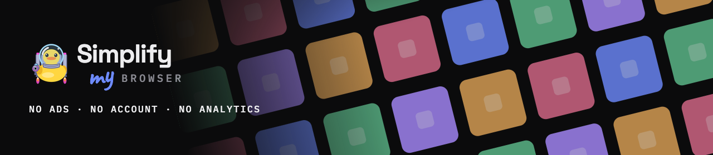
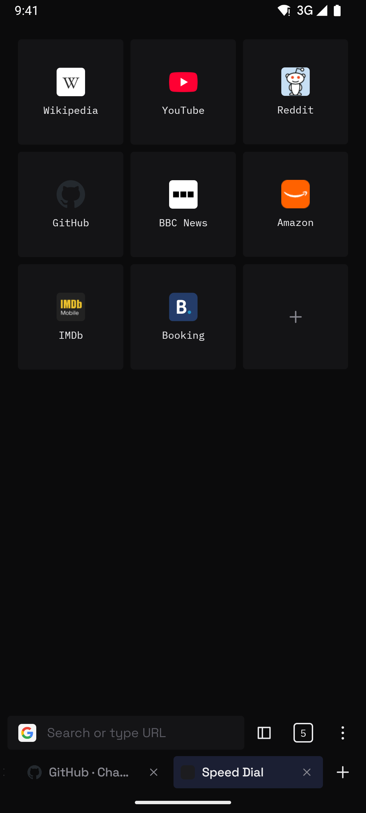
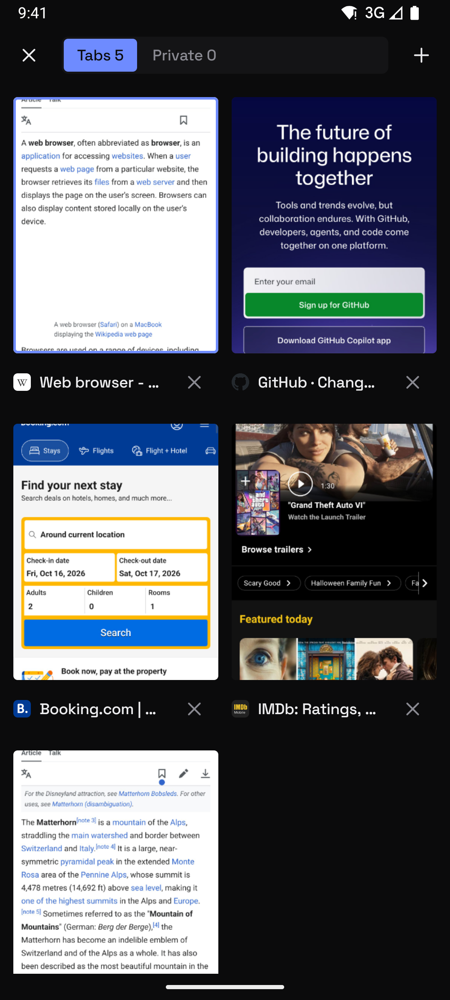
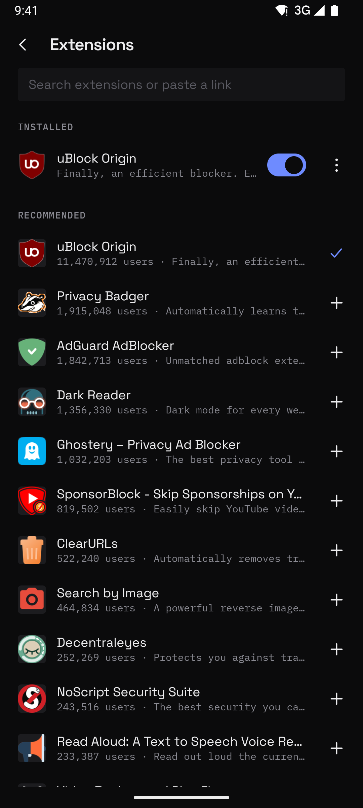
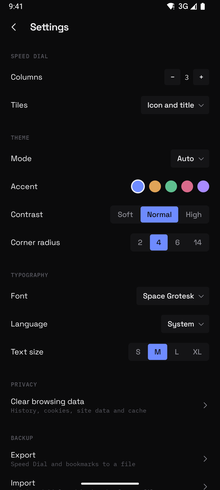

<p align="center">
  
</p>
<p align="center">
  <b>The web, with nothing in the way.</b><br>
  Free. No ads, no account, no analytics. Real extensions.
</p>

<p align="center">
  <a href="https://simplifymy.app/">Website</a> ·
  <a href="https://github.com/simplifymy-app/browser/releases">Changelog</a>
</p>

> [!WARNING]
> **Experimental.** This browser is an early, experimental project. It is provided as is, without warranty of any kind, and may lose data, break or change at any time. If you use it, you do so entirely at your own risk. See [LICENSE](LICENSE).

<p align="center">
  
  
  
</p>

A browser for Android on Gecko, with the extensions you know from the desktop. Search for uBlock Origin, Dark Reader or Privacy Badger and add them in one tap — they install from addons.mozilla.org, not from a list someone picked for you. Around the engine sits the same quiet interface as the other Simplify apps: a Speed Dial, a tab strip and a menu that only holds what you use.

## ✦ What it does

| | |
| --- | --- |
| **Extensions** | Search addons.mozilla.org or paste a link, one-tap install, permission prompt, options pages, popups, automatic updates |
| **Speed Dial** | Your sites as tiles: icon, icon and title, or a preview of the page. Two to six columns, hold and drag to reorder |
| **Tabs** | A tab strip under the address bar and a switcher with previews. Private tabs go black and leave nothing behind |
| **Address bar** | Shows where you are, a shield when the connection is secure, and the search engine picker when you type |
| **Search** | Google, Bing, DuckDuckGo, Ecosia, Qwant, Wikipedia and more, switched from the address bar |
| **Library** | Bookmarks, history and downloads behind the panel button. Save any page as PDF |
| **Pages** | Mobile or desktop view per tab, long-press menu for links and images, site permissions with an option to remember |
| **Make it yours** | Light, dark or pure black, five accents, four fonts, text size, toolbar at the top or bottom, hide it on scroll |
| **Keep** | Speed Dial and bookmarks exported to one file and imported back on another phone |

There is no analytics, no crash reporting and no account in the app. Besides the sites you open, it talks to addons.mozilla.org to search, install and update extensions. Blocking ads is uBlock Origin's job — you install it, the browser does not pretend to.



## 📦 Install

Experimental builds are on the [Releases](https://github.com/simplifymy-app/browser/releases) page — use them at your own risk. Android 8.0 or newer.

## 🔨 Build

You need JDK 17+ and the Android SDK. Use the Makefile, not raw gradle.

```
make run        # install the debug build for the device's ABI and launch it
make apk        # minified release APK for one ABI into dist/ (ABI=arm64-v8a)
make apk-debug  # debug APK for one ABI into dist/, for testers
make bundle     # signed release AAB into dist/, for Google Play
make emulator   # boot an AVD
make logcat     # follow the app log
make lint       # android lint over the debug variant
```

`make help` lists the rest. The engine is large, so the build splits APKs by ABI and `make install` streams the one the device needs instead of copying it twice.

Release builds are signed with the Play upload key from `keystore.properties`, which is not in the repository. Without it they fall back to the debug keystore, so a fresh clone still builds an installable APK.

## 🧭 Layout

```
Components       the engine, store, storage and use cases, created once
core/addons      addons.mozilla.org search and links
core/backup      JSON export and import of Speed Dial and bookmarks
core/database    Room: Speed Dial tiles and their page previews
core/search      search engine choices over the bundled list
core/settings    BrowserSettings in DataStore, app language
ui/theme         Simplify tokens, shared with the other apps
ui/component     controls, menus, dialogs and hand-drawn icons
feature/browser  toolbar, address bar, tab strip, menu, the browser screen
feature/tabs     tab switcher
feature/speeddial new tab page
feature/addons   extensions screen, install prompts, popups
feature/library  bookmarks, history, downloads
feature/settings every setting
```

Kotlin and Jetpack Compose in a single `:app` module on Mozilla Android Components, powered by Gecko. Manual dependency injection through one `Components` object, no Hilt. Ships in English, Ukrainian, German, Spanish, French and Portuguese; every language always has the same keys.

## 📄 License

© 2026 Simplify my app. The source code is licensed under the [Mozilla Public License 2.0](LICENSE): you may use, change and ship it, also in closed or commercial apps, but changes to these files must stay under the MPL and be shared. It is provided as is, without warranty of any kind.

GeckoView and Mozilla Android Components, which the app is built on, are also under the Mozilla Public License 2.0; their source is in [mozilla-firefox/firefox](https://github.com/mozilla-firefox/firefox). Settings > Open source licenses lists every license bundled with the engine. Extensions installed from addons.mozilla.org carry their own licenses.
